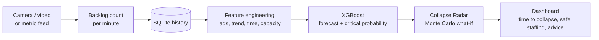

# AI Queue Collapse Predictor


**One engine that predicts when a system is about to collapse under demand, how likely it is, and how many
servers prevent it.** Anything with *arrivals*, a *service capacity* and a *backlog* plugs in as a domain:

| Domain | Backlog | Server | Critical wait |
|---|---|---|---|
| **Physical queues** (canteen, bank, tickets) | people, counted by YOLOv8 from a camera | counter | 12 min |
| **Hospital OPD / ER** | patients | doctor | 90 min |
| **Web / API servers** | pending requests | worker | 1 min |
| **Call centre** | callers on hold | agent | 5 min |

For every domain, **XGBoost** forecasts the backlog and the **Collapse Radar** (a Monte Carlo queue simulation) tells
staff *when* collapse is expected, *how likely* it is, and *what to do*: "Add 2 more counters now". This moves
operations from **reactive** to **proactive**.


## The Collapse Radar

| Current queue | Time to collapse | Collapse probability | Safe staffing |
|:---:|:---:|:---:|:---:|
| 20 people, 2 counters | ~6 min (80% range 3-10) | 88 % | 4 counters |

> Recommendation: *Add 2 more counters now - people are expected to reach 45 in 10 minutes. Collapse expected in about 6 min.*

1. The XGBoost forecast (+h1, +h2, +h3) is converted into an **implied arrival rate** per minute.
2. For every staffing option the radar replays that demand **500 times** with random (Poisson) arrivals, random service
   and an uncertain demand level.
3. A path **collapses** when the wait of a new arrival reaches the domain's critical wait.
4. From the paths it reports the **probability of collapse**, the **time to collapse** (median and 10-90 % range),
   the **uncertainty band** shown on the chart, and the **smallest number of servers** whose collapse probability is
   below 10 %. The *What-if staffing simulator* table lets you apply any option and watch the forecast react.

The same random numbers are reused for every option, so adding a server can never look worse than not adding one.

## Features

- **Multi-domain platform**: physical queues, hospital OPD, web/API servers and call centres on one engine
- **Collapse Radar**: time-to-collapse, collapse probability, peak load and uncertainty band
- **What-if staffing simulator** with one-click apply, and **Inject surge** to stress-test a live feed
- **Early-warning study**: measured warning time against a normal reactive alarm (see Results)
- **Person tracking**: follows every person through a video and measures the *real* arrival rate, service rate and
  waiting time (see [Integrations](#integrations))
- **Alerts** to Telegram, email, SMS (Twilio) or any webhook when collapse is imminent
- **Live metric connector**: reads the backlog of a real system (JSON URL or Prometheus), or accepts pushed readings
- **PDF report** per location: risk episodes, alerts sent, staffing advice and forecast reliability
- **People detection & counting** in images, videos and a live webcam (YOLOv8), with a drawable **queue area**
- **LOW / MEDIUM / HIGH risk**, early-warning log and recommendations in each domain's own words
- **Simulated live feeds** for every domain, so the full demo works without a camera
- **Works offline** after setup; printable **project poster** at `/poster`

## How it works



1. **Sensing:** for physical queues YOLOv8 counts people whose feet are inside the queue area; the other domains
   receive a backlog number per minute (a live simulated feed in the demo).
2. **Features:** current backlog; the backlog 1, 2, 3, 5 and 10 minutes ago; growth and volatility; time of day;
   weekday; open servers; and service capacity.
3. **Models (per domain):** `XGBRegressor`s predict the change in backlog at three horizons (5/10/15 min for queues
   and call centres, 15/30/60 for hospitals, 2/5/10 for web servers) and an `XGBClassifier` predicts the probability
   that the wait reaches the critical level within the main horizon.
4. **Collapse Radar:** see above.
5. **Decision:** wait = backlog / (servers x items served per server per minute). Risk is HIGH at the critical wait or
   >= 60 % critical probability, MEDIUM at the medium wait or >= 30 %.

Domain settings (vocabulary, thresholds, simulated demand) are in [`queue_predictor/domains.py`](queue_predictor/domains.py).
**Adding a new domain is one `Domain(...)` entry** plus `python -m queue_predictor.train --domain <key>`.
Other tuning constants are in [`queue_predictor/config.py`](queue_predictor/config.py).

## Integrations

### Person tracking and real flow measurement
`Measure real flow` (physical queues) follows every person through a video with a ByteTrack-style tracker
([`tracker.py`](queue_predictor/tracker.py)): confident detections are matched to existing tracks first, then weak
detections (people half hidden in the queue) get a second chance to keep a track alive. From the tracks it measures:

- **arrival rate** (people entering the queue area per minute),
- **service rate** (people leaving it per minute while the queue is busy) and the implied **service time per counter**,
- the **average waiting time** (time between entering and leaving) and the utilisation (arrivals / served).

**Use measured service time** copies the measurement into the settings, so the forecast no longer relies on a guess.
People already in the queue at the start of the video, or still there at its end, are not counted, because their
entry or exit was not seen. A person who leaves the area counts as served; giving up cannot be told apart.
The tracker is our own implementation of ByteTrack's association idea (no Kalman filter), not the Ultralytics tracker.

### Alerts
When the Collapse Radar says **collapse imminent / collapsed**, or the risk is HIGH, the system raises an alert:

| Channel | You provide |
|---|---|
| Dashboard log | nothing (always on) |
| Telegram | bot token (from @BotFather) and chat ID |
| Email | SMTP host, port, login, from and to addresses |
| SMS | Twilio account SID, auth token, from and to numbers |
| Webhook | a URL (Slack and Discord incoming webhooks work) |

An alert is repeated only when the situation gets worse or after the cool-down (default 5 min). Settings are stored in
`data/alerts.json` on the computer running the dashboard; secrets are masked in the browser. **Send test message**
checks a channel. The channel senders were tested with fakes, not against the real services, so test each one once.

### Live metric connector
Any location can read its backlog from a real system every N seconds (minimum 5):

- **JSON URL**: GET a URL and pick the number with a dotted path such as `data.queue_depth`;
- **Prometheus**: run an instant query such as `sum(http_requests_in_flight)` against `http://host:9090`;
- **Push**: `POST /api/ingest/<location id>` with `{"count": 42}` or `{"readings": [{"ts": "...", "count": 42}]}`.

### PDF report
**Download report (PDF)** (top right) creates a one-page report for the selected location: summary of the last 24 hours,
collapse-risk episodes, alerts sent, the staffing advice table, measured flow if available, and how reliable the
forecasts are.

## Results

Everything is evaluated on days the models never saw during training (time-based split, last 20 % of days).
Training saves, per domain, `models/<domain>_metrics.json` with:

- forecast accuracy (R2 and average error against the naive "no change" guess, overall and in busy periods);
- the **critical-congestion classifier** ROC-AUC;
- the **early-warning study**: for every collapse on the unseen days, how many minutes earlier than a reactive alarm
  (which fires when the wait is already critical) each method warned, and how many false alarms per day it raised.

The numbers are shown on the dashboard (*Model accuracy* and *Early-warning study*) and on the poster. Sudden bursts
(class break, ambulance wave, flash sale) cannot be seen in advance, so no method warns early for every collapse;
the study reports this honestly.

### About the training data

No public minute-by-minute backlog dataset exists for these systems, so the models are trained on simulated days
([`simulate.py`](queue_predictor/simulate.py)) with rush hours, sudden bursts, quieter weekends, people giving up
on long queues, varying service speed, and under- and over-staffing. Every count the system sees is stored in
`data/queue.db`, so the same pipeline can be retrained on real data once it has been collected.

## Project structure

```
queue-collapse-predictor/
├── queue_predictor/          # application package
│   ├── alerts.py             # Telegram / email / SMS / webhook alerts and the alert log
│   ├── app.py                # Flask backend and REST API
│   ├── config.py             # paths, radar and risk settings
│   ├── connectors.py         # live metric feeds (JSON URL, Prometheus)
│   ├── database.py           # SQLite storage
│   ├── detector.py           # YOLOv8 person detection (OpenCV HOG fallback)
│   ├── domains.py            # the four application domains (vocabulary, thresholds, demand)
│   ├── features.py           # feature engineering
│   ├── predictor.py          # forecast, waiting time, risk, radar, recommendation
│   ├── radar.py              # Collapse Radar: Monte Carlo time-to-collapse + what-if staffing
│   ├── report.py             # PDF report
│   ├── simulate.py           # demand simulator (training data + live demo)
│   ├── tracker.py            # ByteTrack-style person tracking + flow measurement
│   ├── train.py              # per-domain training, evaluation, early-warning study
│   ├── templates/            # dashboard and poster pages
│   └── static/               # JavaScript, CSS, Chart.js
├── tests/                    # pytest suite (API, models, radar)
├── docs/EXPO_GUIDE.md        # demo script, recording tips, Q&A
├── models/                   # trained models (generated, not committed)
├── data/                     # database, uploads, results (generated, not committed)
├── run.py                    # starts the dashboard
├── start.bat                 # one-click launcher for Windows
├── requirements.txt
└── requirements-dev.txt
```

## Getting started

**Requirements:** Python 3.10+. A GPU is not needed.

```bash
git clone https://github.com/Amitbhardwaj001/queue-collapse-predictor.git
cd queue-collapse-predictor

python -m venv .venv
# Windows: .venv\Scripts\activate    macOS/Linux: source .venv/bin/activate
pip install -r requirements.txt

python -m queue_predictor.train     # trains all four domains (several minutes, once)
python run.py                       # http://127.0.0.1:5000
```

On Windows you can simply double-click **`start.bat`**: it sets everything up on the first run.
The YOLOv8n weights (~6 MB) are downloaded automatically on the first detection. After that the
whole system works without internet.

## Using the dashboard

| Mode | How |
|---|---|
| **Domain** | Pick Physical queues / Hospital / Web / Call centre with the tabs at the top. |
| **Simulated live feed** | Select a simulated location → **Start**. Change the open servers while it runs, press **Inject surge**, or use the what-if table's **Apply** and watch the Collapse Radar react. |
| **Upload footage** | Physical queues → *Main Canteen* → upload a photo or video. Videos are sampled every 10 s, so a clip of a few minutes shows a real trend. |
| **Webcam** | **Start camera**: a frame is analysed every 10 s. |
| **Queue area** | After analysing a frame, drag a box around the queue → **Save area**. |

## REST API

| Method | Endpoint | Description |
|---|---|---|
| `GET` | `/api/domains` | List the application domains |
| `GET` | `/api/locations` | List locations (each has a `domain`) and their settings |
| `POST` | `/api/locations/<id>/settings` | Set `counters` and `service_time_sec` |
| `POST` | `/api/locations/<id>/roi` | Set the queue area `[x1, y1, x2, y2]` (0–1) or `null` |
| `POST` | `/api/locations/<id>/preview` | Recount the last frame with the current queue area |
| `POST` | `/api/upload/<id>` | Upload an image or video → count + prediction (physical queues only) |
| `GET` | `/api/status/<id>` | Prediction incl. `radar` (time to collapse, fan, what-if), history, alerts |
| `POST` | `/api/track/<id>` | Upload a video: track people, measure arrival/service rates, update the forecast |
| `POST` | `/api/locations/<id>/apply-flow` | Use the measured service time as the location's service time |
| `POST` | `/api/ingest/<id>` | Push readings `{"count": n}` or `{"readings": [{"ts", "count"}]}` |
| `GET/POST/DELETE` | `/api/locations/<id>/connector` | Read / save and start / remove a live metric feed |
| `POST` | `/api/locations/<id>/connector/test` | Read the feed once with the submitted settings |
| `GET/POST` | `/api/alerts/settings` | Alert channels and cool-down (secrets masked) |
| `POST` | `/api/alerts/test` | Send a test message to the enabled channels |
| `GET` | `/api/report/<id>.pdf` | PDF report for a location |
| `POST` | `/api/demo/<id>/tick` | Advance the simulated feed by one minute |
| `POST` | `/api/demo/<id>/surge` | Inject a sudden demand surge into the running feed |
| `POST` | `/api/demo/<id>/reset` | Reset the simulated feed |

## Running the tests

```bash
pip install -r requirements-dev.txt
pytest
```

The tests use temporary folders and small models, so your data is never touched.

## Limitations and future work

- Models are trained on simulated data and should be retrained on real data before deployment.
- Only physical queues sense their backlog automatically (camera); the other domains need a live feed
  (JSON URL or Prometheus) or pushed readings. The connectors were tested against fake feeds, not a real server.
- Person tracking was tested on synthetic video. It has not been validated on real canteen footage, and it cannot tell
  a person who was served from one who gave up.
- Alert channels were tested with fakes; Telegram, SMTP and Twilio need your own credentials and a first test message.
- The queue area is a rectangle; winding queues would need a polygon.
- Next steps: validate tracking on real footage, multiple cameras per location, user logins, and a PostgreSQL backend.

## License

Released under the [MIT License](LICENSE). Person detection uses
[Ultralytics YOLOv8](https://github.com/ultralytics/ultralytics), which is licensed separately
under AGPL-3.0.

## Author

**Amit Bhardwaj** · [GitHub @Amitbhardwaj001](https://github.com/Amitbhardwaj001)
