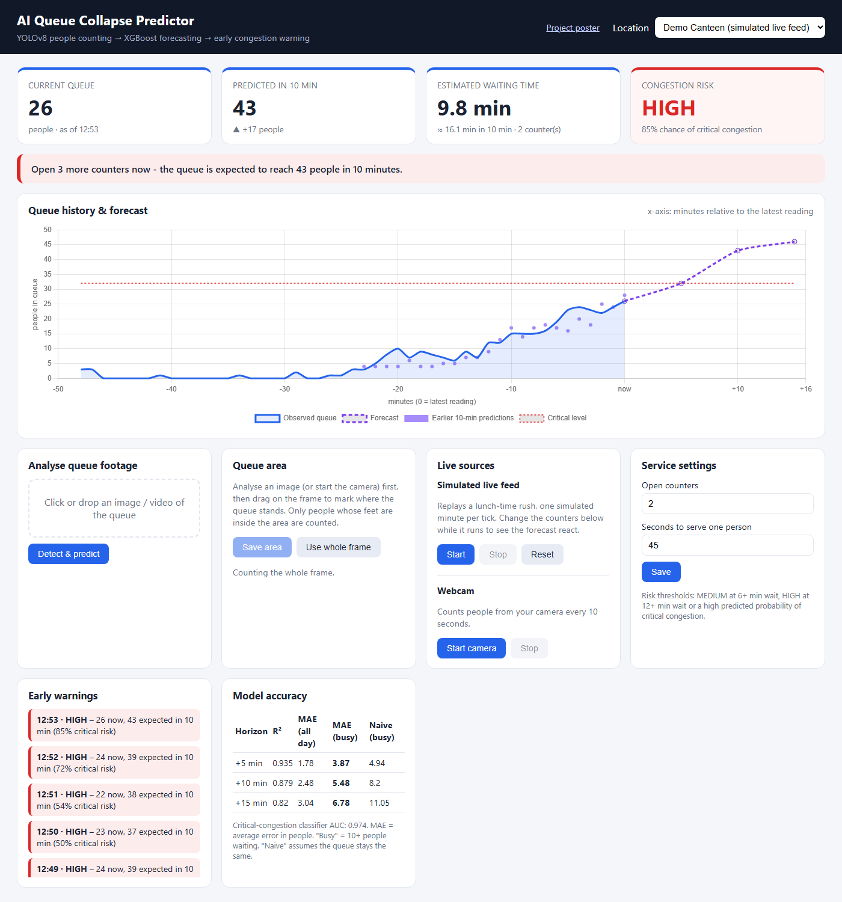
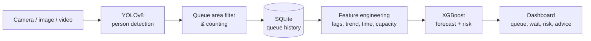

# AI Queue Collapse Predictor


Predicts when a queue is about to become overcrowded, **before** it happens.

The system watches a queue (college canteen, hospital, bank, ticket counter) through a camera,
counts people with **YOLOv8**, learns how the queue develops, and uses **XGBoost** to forecast
the queue size, waiting time and risk of congestion 5–15 minutes ahead. Staff get an early
warning and a concrete recommendation, such as *"Open 1 more counter now"*. This moves queue management from
**reactive** to **proactive**.



## Example

| Current queue | Predicted in 10 min | Expected wait | Risk |
|:---:|:---:|:---:|:---:|
| 20 people | 45 people | 15 min | **HIGH** |

> Recommendation: *Open 1 more counter now – the queue is expected to reach 45 people in 10 minutes.*

## Features

- **People detection & counting** in images, videos and a live webcam (YOLOv8)
- **Queue area (ROI)**: draw the queue zone; people outside it are ignored
- **Queue forecast** for +5, +10 and +15 minutes
- **Waiting-time estimate** now and in 10 minutes
- **LOW / MEDIUM / HIGH risk** plus the probability of critical congestion
- **Early-warning log** and counter recommendations
- **Dashboard** with history, forecast, past predictions and the critical level
- **Simulated live feed** to demonstrate a lunch-time rush without a camera
- **Works offline** after setup; printable **project poster** at `/poster`

## How it works



1. **Detection:** YOLOv8 detects every person in the frame. A person is counted only if their
   feet (bottom centre of the box) are inside the queue area.
2. **History:** each count is stored with a timestamp and turned into a per-minute series.
3. **Features:** current queue; the queue 1, 2, 3, 5 and 10 minutes ago; growth and volatility;
   time of day; weekday; open counters; and service capacity.
4. **Models:**
   - three `XGBRegressor`s predict the change in queue length over the next 5, 10 and 15 minutes;
   - one `XGBClassifier` predicts the probability that the wait reaches the critical level
     (≥ 12 min) within the next 10 minutes.
5. **Decision:** waiting time = people ÷ (counters × people served per counter per minute).
   Risk is HIGH at ≥ 12 min or ≥ 60 % critical probability, and MEDIUM at ≥ 6 min or ≥ 30 %. The
   system recommends enough counters to keep the wait under 8 minutes.

All thresholds are in [`queue_predictor/config.py`](queue_predictor/config.py).

## Results

Evaluated on 30 held-out days the models never saw during training (22,650 minutes).

| Horizon | R² | Avg. error (all day) | Avg. error (busy, 10+ people) | Naive "no change" (busy) |
|---|:---:|:---:|:---:|:---:|
| +5 min | 0.935 | 1.78 people | 3.87 people | 4.94 people |
| +10 min | 0.879 | 2.48 people | **5.48 people** | 8.20 people |
| +15 min | 0.820 | 3.04 people | **6.78 people** | 11.05 people |

**Critical-congestion classifier: ROC-AUC 0.974.** At rush hour the 10-minute forecast is about
33 % more accurate than assuming the queue stays the same.

### About the training data

No public minute-by-minute canteen queue dataset exists, so the models are trained on
150 simulated days ([`simulate.py`](queue_predictor/simulate.py)). The simulation models
breakfast, lunch and evening rushes, class-break surges, quieter weekends, people leaving long queues,
varying service speed, and under- and over-staffing. Every count the system detects is stored in
`data/queue.db`, so the same pipeline can be retrained on real camera data once it has been collected.

## Project structure

```
queue-collapse-predictor/
├── queue_predictor/          # application package
│   ├── app.py                # Flask backend and REST API
│   ├── config.py             # paths, thresholds and settings
│   ├── database.py           # SQLite storage
│   ├── detector.py           # YOLOv8 person detection (OpenCV HOG fallback)
│   ├── features.py           # feature engineering
│   ├── predictor.py          # forecast, waiting time, risk, recommendation
│   ├── simulate.py           # queue simulator (training data + live demo)
│   ├── train.py              # model training and evaluation
│   ├── templates/            # dashboard and poster pages
│   └── static/               # JavaScript, CSS, Chart.js
├── tests/                    # pytest suite (API + model)
├── docs/EXPO_GUIDE.md        # demo script, recording tips, Q&A
├── models/                   # trained models (generated, not committed)
├── data/                     # database, uploads, results (generated, not committed)
├── run.py                    # starts the dashboard
├── start.bat                 # one-click launcher for Windows
├── requirements.txt
└── requirements-dev.txt
```

## Getting started

**Requirements:** Python 3.10+. A GPU is not needed.

```bash
git clone https://github.com/Amitbhardwaj001/queue-collapse-predictor.git
cd queue-collapse-predictor

python -m venv .venv
# Windows: .venv\Scripts\activate    macOS/Linux: source .venv/bin/activate
pip install -r requirements.txt

python -m queue_predictor.train     # trains the models (about a minute)
python run.py                       # http://127.0.0.1:5000
```

On Windows you can simply double-click **`start.bat`**: it sets everything up on the first run.
The YOLOv8n weights (~6 MB) are downloaded automatically on the first detection. After that the
whole system works without internet.

## Using the dashboard

| Mode | How |
|---|---|
| **Simulated live feed** | Select *Demo Canteen* → **Start**. Change *Open counters* while it runs and watch the forecast react. |
| **Upload footage** | Select *Main Canteen* → upload a photo or video. Videos are sampled every 10 s, so a clip of a few minutes shows a real trend. |
| **Webcam** | **Start camera**: a frame is analysed every 10 s. |
| **Queue area** | After analysing a frame, drag a box around the queue → **Save area**. |

## REST API

| Method | Endpoint | Description |
|---|---|---|
| `GET` | `/api/locations` | List locations and their settings |
| `POST` | `/api/locations/<id>/settings` | Set `counters` and `service_time_sec` |
| `POST` | `/api/locations/<id>/roi` | Set the queue area `[x1, y1, x2, y2]` (0–1) or `null` |
| `POST` | `/api/locations/<id>/preview` | Recount the last frame with the current queue area |
| `POST` | `/api/upload/<id>` | Upload an image or video → count + prediction |
| `GET` | `/api/status/<id>` | Current prediction, history, past predictions, alerts |
| `POST` | `/api/demo/<id>/tick` | Advance the simulated feed by one minute |
| `POST` | `/api/demo/<id>/reset` | Reset the simulated feed |

## Running the tests

```bash
pip install -r requirements-dev.txt
pytest
```

The tests use temporary folders and a small model, so your data is never touched.

## Limitations and future work

- Models are trained on simulated data and should be retrained on real camera data before deployment.
- The queue area is a rectangle; winding queues would need a polygon.
- Tightly packed people can hide each other; a higher camera position helps.
- Next steps: person tracking (ByteTrack) to measure real service speed, SMS/app alerts,
  multiple cameras per location, and a PostgreSQL backend.

## License

Released under the [MIT License](LICENSE). Person detection uses
[Ultralytics YOLOv8](https://github.com/ultralytics/ultralytics), which is licensed separately
under AGPL-3.0.

## Author

**Amit Bhardwaj** · [GitHub @Amitbhardwaj001](https://github.com/Amitbhardwaj001)
